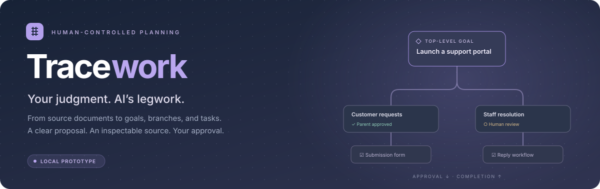
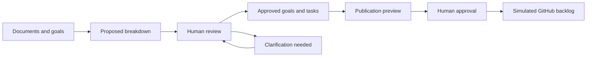

<p align="center">
  
</p>

<p align="center">
  <strong>Turn big ideas into clear, traceable work. Keep people in control.</strong>
</p>

<p align="center">
  <a href="#the-idea">The idea</a> ·
  <a href="#what-you-can-do-today">Features</a> ·
  <a href="#run-it-locally">Quick start</a> ·
  <a href="#take-a-tour">Walkthrough</a> ·
  <a href="#whats-next">Roadmap</a>
</p>

---

## The idea

Tracework is a visual planning tool for turning documents and goals into an implementation backlog. It is built around a simple principle: **AI prepares the work; humans make the decisions.**

Create multiple top-level goals, break them into smaller outcomes, and refine those outcomes into actionable tasks. Explore the hierarchy in a Three.js goal map. Open any node in an overlay to inspect its proposal, sources, assumptions, decisions, dependencies, and history without leaving the map.

The intended destination is a reviewed GitHub backlog, with enough context for a human teammate—and eventually an agent—to pick up a bounded piece of work.

> [!IMPORTANT]
> **This is a working local prototype.** Planning, reviews, document storage, completion tracking, and publication previews are persisted in Laravel. AI generation is scripted, and GitHub publication is simulated. No real model analyzes your uploads, and no GitHub issues are created.

## What you can do today

| Capability | How it works |
| :--- | :--- |
| **Multiple independent goals** | Add objectives with their own branches, decisions, approvals, and tasks. |
| **A visual goal map** | Pan, zoom, expand branches, focus on a node, and fit the hierarchy to the view. A keyboard-accessible outline provides another way to navigate. |
| **Node overlays** | Review and edit a goal or task, inspect evidence, and take available actions while the map stays behind the overlay. |
| **Versioned source documents** | Paste text or upload UTF-8 `.txt` and `.md` files up to 100 KB. Earlier source versions remain available. |
| **Inspectable proposals** | Read source passages with line references, see explicit assumptions, and compare recorded revisions. |
| **Human decision checkpoints** | Review proposed breakdowns and resolve ambiguous requirements before affected work proceeds. |
| **Approval and completion gates** | Approval flows down the hierarchy; completion flows back up. Task prerequisites are enforced separately. |
| **Publication previews** | Select approved nodes, review a batch that includes their goal ancestors, and explicitly approve simulated publication. |
| **Persistent review history** | Save decisions, revision snapshots, completion events, and publication records in the database. |

## How the workflow fits together



A goal describes an **outcome**. A task describes a **bounded piece of implementation work**. Branches can have different depths, and each branch moves forward through its own review checkpoints.

### Approval goes down. Completion comes up.

| Rule | What it means |
| :--- | :--- |
| **Approve the parent first** | A child cannot be approved until its parent and ancestor approvals are current. Required breakdown reviews must also be complete. |
| **Finish the children first** | A parent with four active children stays incomplete until all four children are complete. Rejected proposals are excluded. |
| **Finish prerequisites first** | A task cannot be completed while a prerequisite task is unfinished. |
| **Approval is not completion** | Approving a proposal agrees the plan. Marking it complete confirms the work is finished. |
| **Parents never finish automatically** | Once its children are complete, a person still explicitly marks the parent complete. |

The map uses **solid links for parent–child relationships** and **dashed arrows for prerequisite → dependent task relationships**. Enable **Dependencies** to show prerequisite links. Node cards display progress such as `2/4 children complete`.

### Changes stay visible

- Editing a proposal invalidates its approval and marks descendants for review; unrelated branches retain their approvals.
- Revising a referenced document preserves the original source and flags affected work for review.
- Reopening or changing completed work also reopens completed parents and dependent tasks.
- Approval history records the reviewed revision, actor label, timestamp, and snapshot.
- Stale browser tabs cannot overwrite a newer workspace version, and changed publication previews require a fresh review.

## Run it locally

### Requirements

- PHP **8.3**, Composer, and the PHP extensions needed by Laravel and your database driver.
- Node.js **20.19+ or 22.12+**, with npm.
- PostgreSQL, as configured in `.env.example`, or SQLite for a lightweight local setup.
- A browser with WebGL support for the Three.js map. The outline remains available if the 3D view cannot initialize.

### 1. Install dependencies

From the project directory:

```bash
composer install
cp .env.example .env
php artisan key:generate --no-interaction
npm ci
```

If you already have a configured `.env`, keep it instead of copying the example over it.

### 2. Configure a database

For **PostgreSQL**, create a local database and update the `DB_*` values in `.env` to match your connection.

For **SQLite**, create a database file:

```bash
touch database/database.sqlite
```

Then set these values in `.env`, using the actual absolute path to your checkout:

```dotenv
DB_CONNECTION=sqlite
DB_DATABASE=/absolute/path/to/i-love-laravel/database/database.sqlite
```

### 3. Initialize the workspace

```bash
php artisan migrate --no-interaction
php artisan db:seed --class=BacklogProjectSeeder --no-interaction
```

The seeder creates the support portal example only if the demo workspace does not already exist. You can also initialize a workspace from the application itself.

### 4. Start development

```bash
composer run dev
```

Open the address printed by the Laravel development server. The development command starts Laravel, Vite, the queue listener, and the log viewer.

**No AI API key or GitHub credentials are required for this prototype.**

## Take a tour

1. **Explore the example.** The support portal scenario includes approved goals, draft tasks, an unresolved attachment policy, and an independent staff workflow.
2. **Select a node.** Its overlay shows the proposal, evidence, available actions, completion blockers, and history. Use **Close** or **Escape** to return to the map.
3. **Resolve a question.** Review the suggested attachment policy, accept it or enter your own answer, then approve the affected breakdown.
4. **Add another goal.** Choose **+ Add goal**, enter an objective, approve it, and request a scripted breakdown. Review and adapt the generic suggestions to your goal.
5. **Follow the gates.** Approve parents before children. Complete prerequisite tasks and child nodes before marking their dependents and parents complete.
6. **Preview publication.** In **GitHub publishing**, select eligible nodes, prepare a batch, inspect its contents, and approve the simulation.

> [!NOTE]
> The support portal example uses fixed source references. New custom goals receive generic scripted breakdowns, without invented document evidence. Uploaded text is saved for inspection; it is not interpreted by a real AI model.

**Reset demo** offers a fresh workspace or the example scenario. Resetting requires confirmation and replaces saved documents, edits, decisions, approvals, and simulated publication batches.

## Under the hood

| Layer | Technology / responsibility |
| :--- | :--- |
| Backend | Laravel 12 on PHP 8.3; validation, workflow transitions, persistence, and concurrency checks. |
| Interface | React 19 and MUI 7; review overlays, forms, navigation, and accessible controls. |
| Visualization | Three.js; layered goal trees, relationship links, camera controls, and node labels. |
| Assets | Vite 7. |
| Admin foundation | Filament 5 is installed; the planning experience is the custom React application. |
| Verification | PHPUnit 11 and Laravel Pint. |

The prototype stores one shared workspace as a **versioned JSON snapshot** in the `backlog_projects` table. Source versions, goal/task nodes, decisions, history, and publication batches are saved together. Mutations run in database transactions and check the submitted workspace version.

Useful starting points:

- [`BacklogWorkflow`](app/Services/BacklogWorkflow.php): server-enforced approvals, completion rules, invalidation, and publication simulation.
- [`DemoScenario`](app/Services/DemoScenario.php): deterministic example proposals and generic goal breakdowns.
- [`GoalTree`](resources/js/GoalTree.jsx) and [`NodeWorkspace`](resources/js/NodeWorkspace.jsx): visualization and node overlays.
- [`BacklogWorkflowTest`](tests/Feature/BacklogWorkflowTest.php): workflow behavior and failure cases.

### Development checks

```bash
# Workflow feature tests
php artisan test --compact tests/Feature/BacklogWorkflowTest.php

# Full test suite
php artisan test --compact

# Format modified PHP files
vendor/bin/pint --dirty --format agent

# Compile frontend assets
npm run build
```

Tests cover approval gates, completion prerequisites, reopening propagation, dependency cycles, source versioning, upload validation, stale writes, branch isolation, and repeat-safe simulated publication.

## Prototype boundaries

This release is intended for **local exploration in a single shared workspace**. The planning endpoints do not provide user authentication, team permissions, or tenant isolation. Reviewer names in the history are demo labels rather than verified user identities.

AI generation and GitHub publication are simulations. PDF and Word ingestion, real repository inspection, human assignment, and agent execution are not implemented. Keep these boundaries in mind when demonstrating the tool or extending it toward a hosted product.

## What’s next

- [ ] Real AI document analysis with structured, source-linked proposals.
- [ ] GitHub authentication and real issue publishing with hierarchy preservation.
- [ ] User accounts, team permissions, and human task assignment.
- [ ] Richer document ingestion, including PDF and Word.
- [ ] Repository-aware planning and proposed issue updates when requirements change.
- [ ] Production authentication, observability, performance, and deployment work.
- [ ] Eventually, controlled assignment of approved tasks to agents or swarms.

---

<p align="center">
  <strong>Your judgment. AI’s legwork.</strong><br />
  <sub>Evidence you can inspect. Decisions you control.</sub>
</p>
